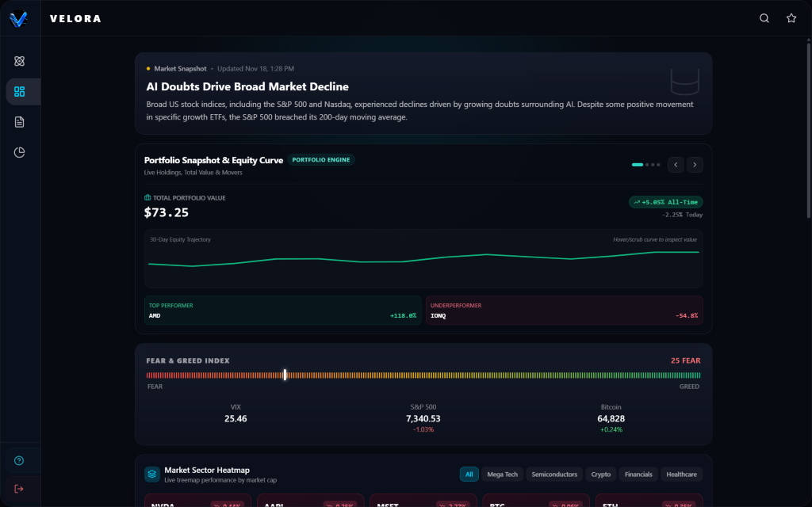
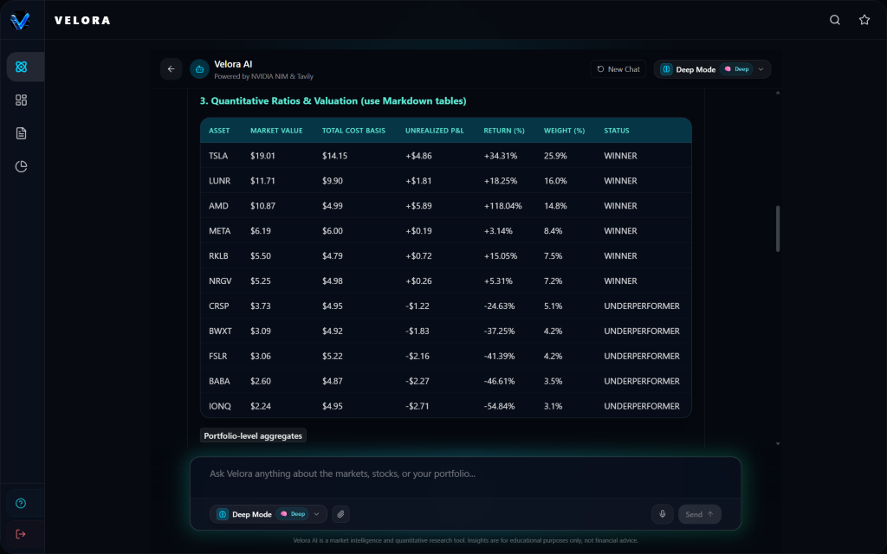
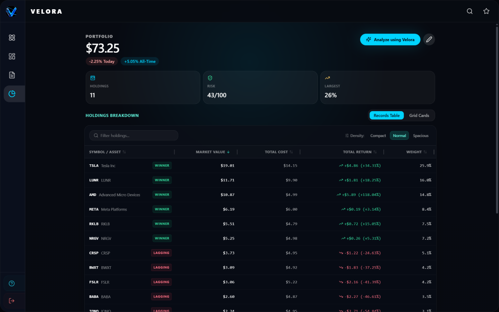
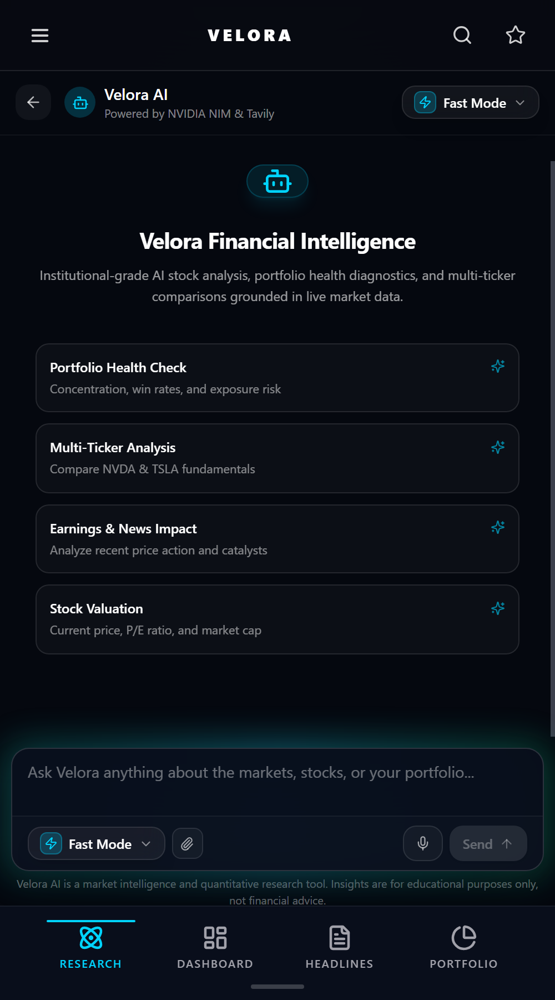
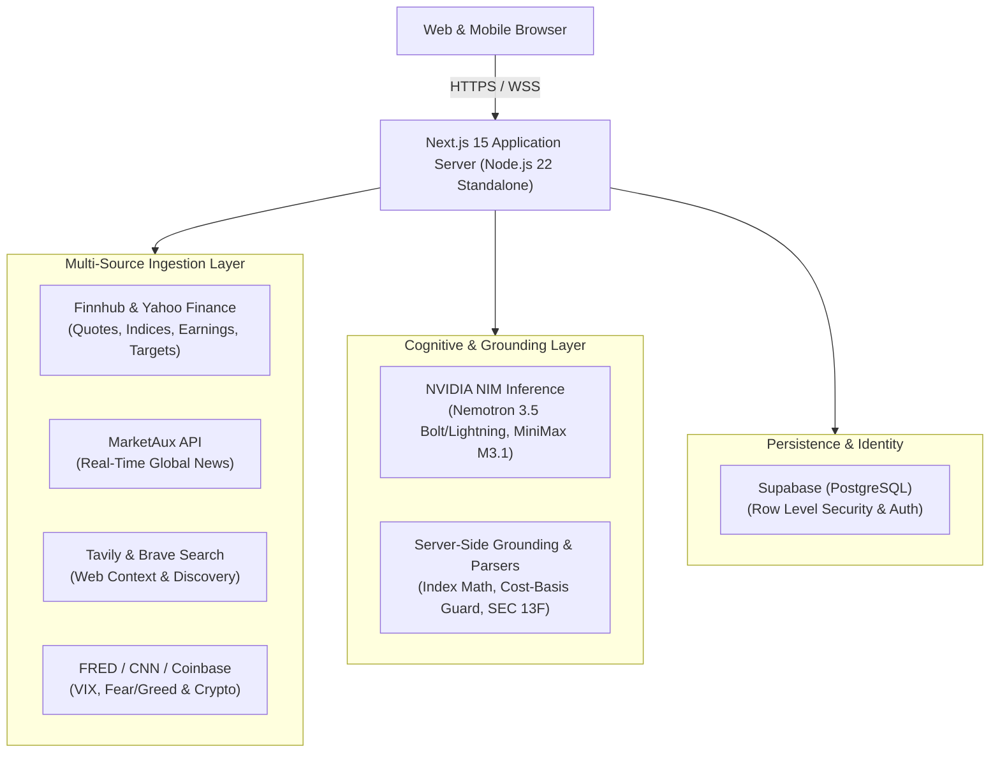

# Velora

<p align="center">
  
</p>

<p align="center">
  <strong>Open-Source Financial Research Engine & Market Intelligence Platform</strong>
</p>

<p align="center">
  <strong>Live demo: <a href="https://velora.anishdubey.com">https://velora.anishdubey.com</a></strong>
</p>

<p align="center">
  Explore the live market dashboard, macro sentiment indicators, breaking news, SEC/congressional disclosures, stock detail pages, and Velora AI market research without signing up. A test account is available on request for the authenticated portfolio tracking and health-check workflow.
</p>

<p align="center">
  <a href="LICENSE"></a>
  <a href="https://nextjs.org/"></a>
  <a href="https://www.typescriptlang.org/"></a>
  <a href="https://www.docker.com/"></a>
  <a href="https://github.com/anishdubey27/velora/actions/workflows/ci.yml"></a>
  <a href="https://github.com/anishdubey27/velora/actions/workflows/production.yml"></a>
</p>

---

## Overview

**Velora** is an open-source financial research engine and market intelligence platform designed to bridge institutional-grade intelligence and retail accessibility. It combines real-time financial market data feeds (**Finnhub**, **Yahoo Finance**, **MarketAux**, **Tavily**, **Brave Search**), cloud **PostgreSQL** persistence via Supabase, and contextual **Large Language Model (LLM)** synthesis into a unified, responsive interface.

Velora autonomously ingests breaking macro news, cross-references live ticker telemetry (S&P 500, VIX, CNN Fear & Greed, Coinbase crypto streams), evaluates congressional and insider trading disclosures, and computes real-time portfolio risk metrics (Sharpe Ratio, Beta, Volatility).

Velora provides research and summaries for education; it does not provide investment advice.

---

## See It in Action

### Market Dashboard & Live Portfolio Snapshot (Desktop)


### Grounded AI Portfolio Health Check (Desktop)


### Portfolio Holdings & Records Table (Desktop)


### Responsive Mobile Chat Experience (Phone)
<p align="center">
  
</p>

---

## Core Architecture & Stack

Velora is architected around high-efficiency, edge-ready web technologies and containerized services:



### Technology Matrix

| Domain | Technology | Purpose |
|---|---|---|
| **Frontend & Server** | [Next.js 15 (App Router)](https://nextjs.org/) | Server Components, dynamic streaming, and server actions |
| **Language** | [TypeScript 5.7](https://www.typescriptlang.org/) | Strict end-to-end type safety |
| **Styling & UI** | [Tailwind CSS 3](https://tailwindcss.com/) + [Lucide Icons](https://lucide.dev/) | High-contrast, responsive dark-mode financial telemetry |
| **Animations & Graphs** | [Framer Motion](https://www.framer.com/motion/) + [Recharts](https://recharts.org/) | Smooth micro-interactions and dynamic financial data charts |
| **Database & Auth** | [Supabase](https://supabase.com/) / [PostgreSQL](https://www.postgresql.org/) | Secure authentication, user holdings, and Row Level Security |
| **AI Inference** | [NVIDIA NIM](https://build.nvidia.com/) (`nvidia/nemotron-3.5-bolt-e4b`, `minimaxai/minimax-m3.1-flash`, `nvidia/nemotron-3.5-lightning-30b-a3b`) | Contextual prompt skills, research synthesis, streaming market & portfolio Q&A |
| **Market Ingestion** | Finnhub, Yahoo Finance, MarketAux, Tavily, Brave Search, FRED, SEC EDGAR | Real-time pricing, session-aware indices, global news sentiment, 13F disclosures |
| **Containerization** | [Docker](https://www.docker.com/) & [Docker Compose](https://docs.docker.com/compose/) | Multi-stage slim runtime bounded to low memory footprints |
| **CI/CD & Security** | [GitHub Actions](https://github.com/features/actions) + [Trivy](https://github.com/aquasecurity/trivy) | Automated linting, regression tests, vulnerability auditing, GHCR publishing |

---

## Key Features

- **Multi-Source Financial Data Ingestion**:
  - Live quote streams and day changes via Finnhub with automatic Yahoo Finance fallback.
  - Multi-region news filtering (US, India, Crypto) with sentiment weighting via MarketAux.
  - CNN Business Fear & Greed Index with Alternative.me crypto fallback.
  - VIX Volatility telemetry from FRED & Finnhub.
  - Session-aware global indices (S&P 500, NASDAQ, Nifty 50) and 24/7 crypto spot prices from Coinbase Exchange.

- **AI-Driven Market & Filing Research Synthesis**:
  - Modular AI analysis skills ranked dynamically by breaking market events, with Fast (`nemotron-3.5-bolt-e4b`) and Deep (`minimax-m3.1-flash`) modes.
  - Automated analysis of company profiles, position and disclosure analysis, insider filings (Form 4), and congressional disclosures.
  - Super-investor 13F portfolio analysis and institutional position breakdowns.

- **Portfolio Risk Metrics & Pulse**:
  - Secure portfolio management with Supabase authentication and owner-only Row Level Security.
  - Real-time valuation updates, sortable Records Table, and interactive allocation views.
  - Computed risk telemetry: Volatility, Sharpe Ratio, Beta, and grounded AI portfolio health checks.

- **Self-Hostable Containerized Deployment**:
  - Lean multi-stage Docker build utilizing `node:22-alpine` and Next.js standalone mode.
  - Hard memory cap (`700MB`) configured for resource-constrained virtual machines (e.g., Oracle Cloud Always-Free tier).
  - Production service worker with Network-First navigation and automatic cache purging.

---

## Engineering Highlights

- **Production Deployment on Oracle Cloud**: Runs as a containerized Next.js 15 standalone app managed by Docker Compose behind nginx (700 MB memory limit). Every push to `main` is linted, tested, vulnerability-scanned with Trivy, built by GitHub Actions, published to GHCR (`ghcr.io/anishdubey27/velora:latest`), and auto-deployed to the host (SSH pull/restart and Watchtower).
- **Data Correctness Discipline**: A single canonical portfolio computation drives the Dashboard Portfolio Snapshot card, the Portfolio Records Table, and AI Health Check responses—so total value, total cost basis, unrealized P&L, and per-holding status agree to the cent across every surface.
- **AI Grounding & Deterministic Output Guards**: Model answers are grounded in live server-fetched market and portfolio context, paired with a deterministic server-side streaming guard (`lib/cost-basis-guard.ts`) that rewrites mislabelled total-cost-as-per-share figures before tokens reach the client, alongside table sanitization that strips duplicate or `N/A` rows.
- **Security (Supabase Row Level Security)**: Owner-only RLS policies (`auth.uid() = user_id`) are enforced on all user tables (`holdings`, `watchlist`). A leftover legacy table discovered with RLS disabled was removed and the fix verified.
- **Resilience Patterns**: Quote ingestion enforces per-symbol fetch timeouts with an automatic Yahoo Finance fallback when Finnhub fails or rate-limits, backed by a 20-second server-side quote cache, automatic mobile session refresh, and explicit `loading / ready / empty / unauthenticated / error` UI states—preventing infinite loading skeletons.
- **Session-Aware Market Math**: Index levels and daily changes (`lib/index-grounding.ts`) are computed against the previous completed exchange session's close rather than rolling metadata, verified directly against exchange session data.

---

## Local Development Quickstart

Follow these steps to set up Velora in your local development environment.

### Prerequisites

Ensure the following tools are installed on your workstation:
- **Node.js**: `v20.x` or `v22.x` (LTS recommended)
- **npm**: `v10.x` or higher
- **Git**: `v2.40+`
- **Docker & Docker Compose** *(optional, for running containerized)*

### 1. Clone the Repository

```bash
git clone https://github.com/anishdubey27/velora.git
cd velora
```

### 2. Configure Environment Variables

Velora uses an `.env.example` file documenting all required and optional configuration keys. Copy the template to `.env.local`:

```bash
cp .env.example .env.local
```

#### Environment Variables Breakdown

| Variable | Required | Description |
|---|---|---|
| `NEXT_PUBLIC_SUPABASE_URL` | **Yes** | Your Supabase project URL (`https://<project-id>.supabase.co`) |
| `NEXT_PUBLIC_SUPABASE_PUBLISHABLE_KEY` | **Yes** | Supabase anonymous public key for authentication and client requests |
| `NEXT_PUBLIC_SITE_URL` | No | Base URL for auth redirects (default: `http://localhost:9999`) |
| `NVIDIA_API_KEY` | **Yes** | NVIDIA NIM API key for AI chat and contextual research skills |
| `NVIDIA_DEFAULT_MODEL` | No | Model identifier (defaults to `nvidia/nemotron-3.5-bolt-e4b`) |
| `FINNHUB_API_KEY` | **Yes** | API key for stock quotes, analyst targets, insider trades, and earnings |
| `MARKETAUX_API_KEY` | **Yes** | API key for live global financial news streams and sentiment |
| `FRED_API_KEY` | No | Federal Reserve Economic Data API key for macroeconomic & VIX data |
| `BRAVE_SEARCH_API_KEY` | No | Brave Search API key for real-time web retrieval |
| `TAVILY_API_KEY` | No | Tavily search API key for agentic financial document discovery |

### 3. Install Dependencies

```bash
npm install
```

### 4. Initialize Database Schema (Supabase)

In your Supabase project's SQL Editor, execute the following script to create the user holdings table with Row Level Security:

```sql
create table if not exists holdings (
  id uuid default gen_random_uuid() primary key,
  user_id uuid references auth.users not null,
  symbol text not null,
  name text not null,
  shares numeric not null,
  purchase_price numeric not null,
  created_at timestamptz default now()
);

alter table holdings enable row level security;

create policy "Users manage own holdings"
  on holdings for all
  using (auth.uid() = user_id)
  with check (auth.uid() = user_id);
```

### 5. Launch the Development Server

```bash
npm run dev
```

Visit [http://localhost:9999](http://localhost:9999) (or your configured port) in your browser.

### 6. Containerized Deployment (Docker Compose)

To build and run Velora in a production-identical containerized stack:

```bash
# 1. Create .env from template
cp .env.example .env

# 2. Start the container
docker compose up -d

# 3. View logs
docker compose logs -f velora-app
```

The app will be accessible at [http://localhost:3000](http://localhost:3000).

---

## API Routes Reference

| Endpoint | Upstream Source | Description |
|---|---|---|
| `GET /api/news` | MarketAux / Brave | Real-time news filterable by region (US, India, Crypto) and impact |
| `GET /api/fear-greed` | CNN / Alternative.me | Market sentiment index (0-100) with historical trends |
| `GET /api/vix` | FRED / Finnhub | CBOE Volatility Index data and daily fluctuation |
| `GET /api/portfolio` | Finnhub / Yahoo Finance | Real-time price quotes with 20s cache and Yahoo Finance fallback |
| `GET /api/skills` | MarketAux | Dynamically ranked AI skills triggered by trending news |
| `GET /api/dashboard/indicators` | Yahoo Finance / Finnhub / Coinbase | Session-aware S&P 500 benchmark and Bitcoin spot market indices |
| `GET /api/dashboard/signals` | Finnhub | Wall Street consensus price targets and analyst ratings |
| `GET /api/dashboard/events` | Finnhub | Upcoming corporate earnings calls and macroeconomic releases |
| `GET /api/signals/insider` | Finnhub | Form 4 SEC insider buying and selling transactions |
| `GET /api/signals/super-investors` | SEC EDGAR / 13F | Institutional holdings and portfolio allocations |
| `POST /api/ai` | NVIDIA NIM / Tavily | Contextual streaming chat completions with financial grounding and output guards |

---

## DevOps & Production Infrastructure

Velora is engineered for continuous delivery and low-footprint operations:

- **Automated Security Auditing**: Every push to `main` runs a [Trivy](https://github.com/aquasecurity/trivy) container vulnerability scan auditing OS and library dependencies for critical CVEs, alongside ESLint, regression tests (`npm test`), and build verification in CI.
- **Ultra-Lean Multi-Stage Image**: Standalone Next.js output packaging drops unnecessary build dependencies, producing a minimal Alpine Linux runner.
- **Resource Limits**: The container is constrained to a 700MB memory ceiling, preventing out-of-memory kernel panics on free-tier 1GB cloud instances.
- **Continuous Deployment**: Commits pushed to `main` compile and publish to GitHub Container Registry (`ghcr.io/anishdubey27/velora:latest`) and auto-deploy on Oracle Cloud behind nginx (Docker Compose SSH update and Watchtower).

---

## Roadmap & OpenAI Codex Integration

As part of our participation and review under the **OpenAI Codex for Open Source maintainer program**, Velora is actively expanding its developer infrastructure and automated reasoning pipelines:

- [ ] **Automated PR Review Agent**: Deploying an OpenAI Codex-powered review harness to evaluate community pull requests against Next.js 15 performance patterns, TypeScript strictness, and zero-mock integrity.
- [ ] **Financial Parsing Benchmarks**: Standardized evaluation benchmarks testing LLM accuracy on tabular 10-K balance sheet data, earnings call sentiment extraction, and quantitative risk modeling.
- [ ] **Security Test Harnesses**: Automated CI penetration testing verifying authentication boundaries, Supabase RLS policy enforcement, and prompt-injection defenses.
- [ ] **Decoupled Python Extraction Engine**: Expanding dedicated Python microservices for high-throughput SEC EDGAR 13F filing parsing and quantitative risk calculation.
- [ ] **OpenTelemetry & Distributed Tracing**: Native OpenTelemetry instrumentation across API routes and third-party financial provider latencies.

---

## Contributing

We welcome contributions! Please review our [CONTRIBUTING.md](CONTRIBUTING.md) guide for details on:
- Branch naming standards (`feat/...`, `fix/...`, `docs/...`)
- Commit message conventions
- Verification steps (`npm run lint`, `npm test`, `npm run build`)
- Community code of conduct

---

## Maintainer

Velora is conceived and maintained by:

**Anish Dubey**  
- GitHub: [@AnishDubey27](https://github.com/AnishDubey27)  
- Website: [anishdubey.com](https://anishdubey.com)  
- Repository: [github.com/anishdubey27/velora](https://github.com/anishdubey27/velora)

---

## License

This project is open-source software licensed under the **[MIT License](LICENSE)**.  
Copyright &copy; 2026 Anish Dubey. All rights reserved.
